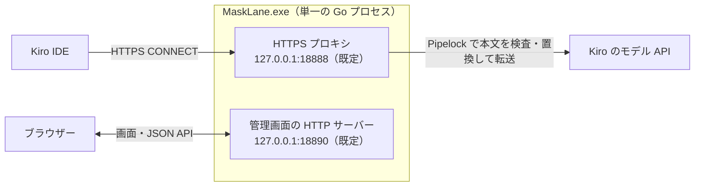

# MaskLane

Kiro IDE が送る本文に含まれる登録済みのキーワードを、Windows 上でマスキングする試用版です。Pipelock 3.8.0 の辞書置換と HTTPS プロキシを利用しています。

## 使い方

### Kiro を MaskLane 経由で起動する

1. [Releases](https://github.com/reqnote/MaskLane/releases) から Windows x64 用の ZIP を入手して展開し、`MaskLane.exe` を起動します。ブラウザーに管理画面が開きます。
2. Kiro IDE が起動していれば完全に終了します。
3. MaskLane の「使い方」で「コマンドをコピー」を押し、Windows の PowerShell に貼り付けて実行します。コマンドが Kiro の場所を探して起動します。場所が見つからず入力を求められた場合は、Kiro のショートカットのプロパティにある「リンク先」で `Kiro.exe` のフルパスを確認してください。
4. 管理画面の「通信・キーワード」で試用用のキーワードを登録し、Kiro のチャットでその語を含む文を送ります。「最近の通信」でマスキング結果を確認できます。

コマンドには起動中の MaskLane のプロキシと CA 証明書のパスが入ります。PowerShell は任意のフォルダーで実行できます。TXT ファイル参照の試し方、ステアリング、試用終了時の手順は [Windows 試用ガイド](pilot/Windows-試用ガイド.txt) を参照してください。

### 画面の操作

- 日本語の画面で、キーワードを「企業名」「案件名」「個人名」「社外秘」「その他」に分けて登録できます。「置換後の表記」を空欄にすると、選んだ種類に応じて `<pl:person:1>` などの表記が自動で生成されます。
- 選んだ項目を JSON で共有できます。取り込み時は、既存の設定を優先します。
- 一覧の「置換後の表記」には、送信時に自動生成された表記が表示されます。「最近の通信」で別の送信に切り替えて、応答と照合できます。履歴は時刻、置換数、送信結果、自動生成された表記を実行中だけ保持します。
- 起動時は「文章ツール」の「文章の復元」タブが開きます。「簡易マスク」タブでは文章内の登録語をマスクできます。通信履歴の確認やルールの編集は、上部メニューの「通信・キーワード」で行います。メニューやタブを行き来しても入力と結果は保持されます。「復元欄に移す」を押すと、マスク結果と照合先を引き継いで復元タブに移ります。
- 「文章の復元」で「元の表記に戻す」を押すと、置換名を元のキーワードに戻せます。番号付きの表記を含む文章は、照合先に「直前の簡易マスク」または対応する Kiro の通信を選びます。簡易マスクの対応表は同じブラウザータブ内で、次のマスク成功・ルール変更・再読み込みまで使えます。対応が不明な自動表記や、複数のキーワードに対応する置換名はそのまま残ります。マスクも復元もブラウザー内で処理します。

試用版は Kiro の米国東部と欧州のモデル用エンドポイントを対象としています。ローカルの模擬 HTTPS 通信で置換と検査失敗時の停止を確認しています。Kiro IDE 実機でチャットと TXT の両経路を確認するまでは、試用に架空のキーワードを使ってください。

送信本文は、マスキング前の 1 リクエストあたり既定で 6 MiB（6,144 KiB）まで検査します。上限は 1〜32,768 KiB で調整でき、`MaskLane.exe -max-request-kib 32768` で最大の 32 MiB に設定できます。上限を超える本文は送信を停止し、画面に理由を表示します。この設定は MaskLane 側の上限です。

`MaskLane.exe` を起動すると、証明書、秘密鍵、マスキングルールを実行ファイルと同じ階層の `MaskLane-data` に保存します。Kiro は起動時に `ca.pem` を受け取るため、標準手順では Windows の信頼ストアへの登録は不要です。

プロキシは既定で `127.0.0.1:18888`、管理画面は `127.0.0.1:18890` で起動します。ポートを変える場合は、起動時に `MaskLane.exe -proxy-port 18889 -dashboard-port 18891` のように指定します。管理画面は `-dashboard-port 0` で空きポートを自動選択できます。管理画面を開くときは、起動時に表示される `Dashboard` の URL を使います。

旧版の証明書とルールを引き継ぐ場合は、初回起動前に既存のデータフォルダーを `MaskLane-data` として新しい展開先に移します。移行元の確認と以前の証明書登録の解除は [Windows 試用ガイド](pilot/Windows-試用ガイド.txt) を参照してください。

## 起動時の構成

`MaskLane.exe` を起動すると、Kiro 向けの HTTPS プロキシと、ブラウザー向けの管理画面の HTTP サーバーが、同じ Go プロセス内で立ち上がります。



どちらかのサーバーが待ち受けを終了すると、MaskLane はもう一方も閉じて終了します。利用を再開するには `MaskLane.exe` を起動し直してください。

## ソースからビルド

Windows x64 で Git、PowerShell、`curl.exe`、`tar.exe` を使います。リポジトリのルートで次を実行します。

```powershell
.\build.ps1 -Test
```

ビルドは、固定した Pipelock ソースと Go ツールチェーンを取得してハッシュを検証し、パッチと `overlay` の内容を適用します。`-Test` は置換、HTTPS の模擬通信、日本語画面の API を検証します。`MaskLane.exe` と `MaskLane-Windows-x64.zip` は `dist` に生成されます。

## Pipelock

この試用版は Pipelock 3.8.0 のオープンソース部分を使用しています。利用条件と著作権表示は [LICENSE](third_party/pipelock/LICENSE)・[NOTICE](third_party/pipelock/NOTICE) を参照してください。[Pipelock のソース](https://github.com/pipelab-org/pipelock/tree/556048c1c18d84f7d61d28f686220178a4ff2c4d)
